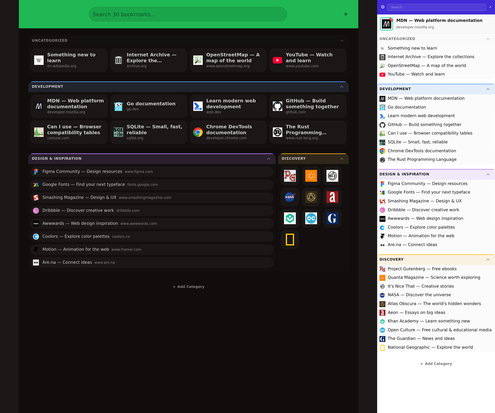

# bookmarkd

Minimalist self-hosted bookmark manager that also acts as a startup page. Comes with a companion browser extension (Firefox/Chrome) that launches in the
sidebar.



## Features

- Import and export bookmarks in `bookmarks.html` format.
- Built-in and custom daisyUI themes.

## Installation

```bash
cp env.template .env
# Configure .env
go run main.go
```

Run behind a reverse proxy with authentication and HTTPS; Bookmarkd does not authenticate requests itself.

For Firefox, download the `.xpi` from releases and install it via `about:addons` → Install Add-on From File.

For sample data, copy `bookmarks.example.json` to `bookmarks.json` before starting the server.
